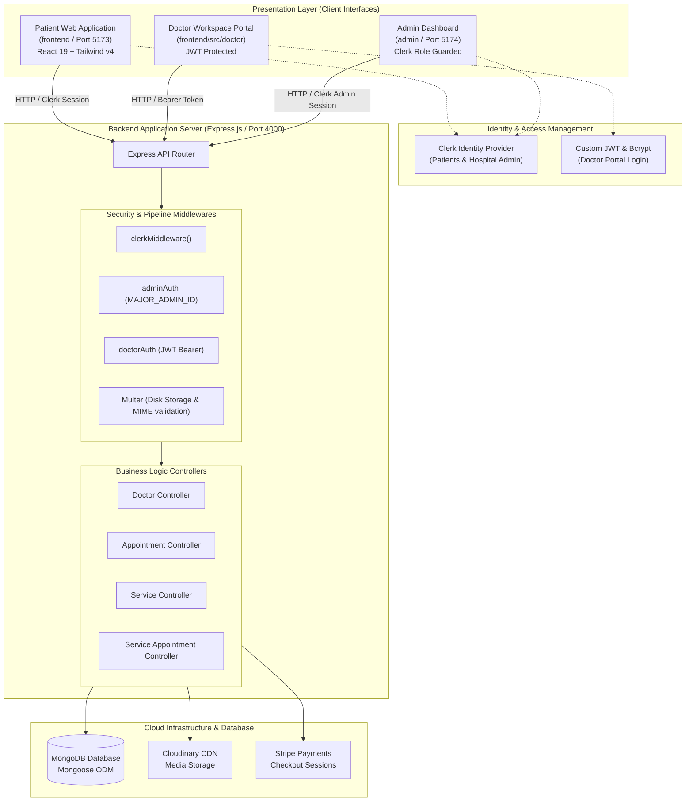
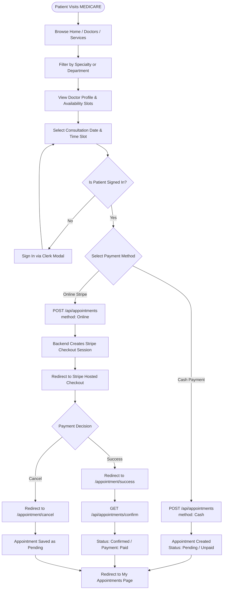
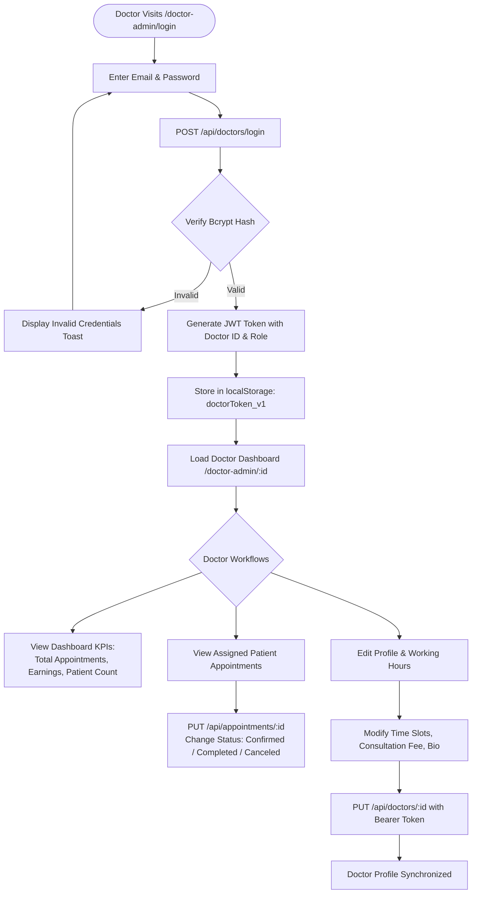
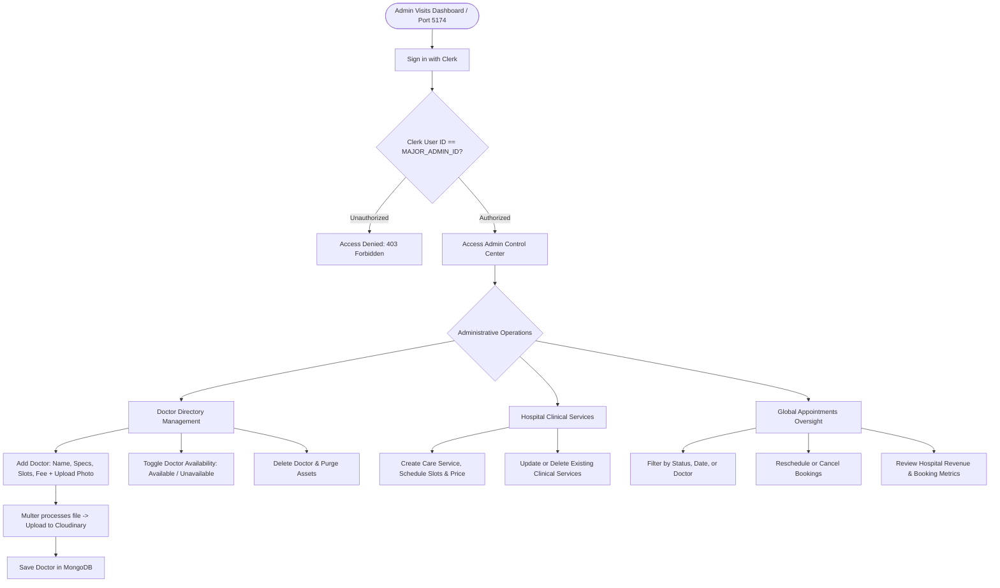
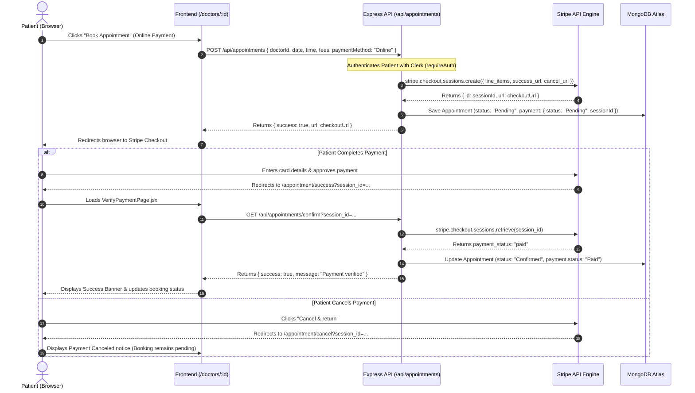

# MEDICARE — Full-Stack Hospital Management System

[](https://react.dev)
[](https://react.dev)
[](https://tailwindcss.com)
[](https://nodejs.org)
[](https://mongodb.com)
[](https://clerk.com)
[](https://stripe.com)
[](https://cloudinary.com)
[](LICENSE)

> A modern, production-grade Healthcare and Hospital Management System featuring multi-role access control (Patients, Doctors, Administrators), intelligent appointment scheduling, hospital clinical services catalog, integrated Stripe payments, Cloudinary media pipeline, and dual-layer authentication.

---

## Table of Contents

- [1. System Architecture](#1-system-architecture)
- [2. User Flow Architecture](#2-user-flow-architecture)
  - [A. Patient User Flow (Discovery to Checkout)](#a-patient-user-flow-discovery-to-checkout)
  - [B. Doctor Portal Flow (Authentication to Schedule Management)](#b-doctor-portal-flow-authentication-to-schedule-management)
  - [C. Hospital Admin Flow (Access Control & Operations)](#c-hospital-admin-flow-access-control--operations)
  - [D. Stripe Payment Lifecycle (Sequence Diagram)](#d-stripe-payment-lifecycle-sequence-diagram)
- [3. Authentication & Security Architecture](#3-authentication--security-architecture)
- [4. Repository Structure](#4-repository-structure)
- [5. Environment Configuration](#5-environment-configuration)
- [6. Local Setup & Installation](#6-local-setup--installation)
- [7. Complete REST API Reference](#7-complete-rest-api-reference)
- [8. Production Deployment Guidelines](#8-production-deployment-guidelines)

---

## 1. System Architecture

The MEDICARE platform is structured into three decoupled subprojects sharing a centralized REST API backend:



---

## 2. User Flow Architecture

### A. Patient User Flow (Discovery to Checkout)



---

### B. Doctor Portal Flow (Authentication to Schedule Management)



---

### C. Hospital Admin Flow (Access Control & Operations)



---

### D. Stripe Payment Lifecycle (Sequence Diagram)



---

## 3. Authentication & Security Architecture

MEDICARE implements a multi-tier authorization matrix ensuring complete segregation of privileges:

| Role | Auth Mechanism | Token / Identifier | Scope & Protected Capabilities |
| :--- | :--- | :--- | :--- |
| **Patient** | Clerk Authentication | Clerk Session Token (`@clerk/react` / `@clerk/express`) | Browse doctors/services, book consultations, pay via Stripe, access personal appointment history (`/api/appointments/me`). |
| **Doctor** | Custom JWT + Bcrypt | Bearer Token (`doctorToken_v1` in `localStorage`) | Access `/doctor-admin/*`, view assigned patient consultations, update appointment statuses, edit fees, bio, and schedule slots. |
| **Hospital Admin** | Clerk Auth + Environment Guard | Clerk User ID matching `MAJOR_ADMIN_ID` | Full CRUD access to doctor listings, hospital services, clinic appointment analytics, and doctor availability overrides. |

### Security Measures Implemented
- **CORS Protection**: Whitelisted origin validation restricting requests exclusively to `http://localhost:5173` (patient/doctor client) and `http://localhost:5174` (admin dashboard).
- **Environment Isolation**: Zero hardcoded secrets; sensitive credentials (`STRIPE_SECRET_KEY`, `CLERK_SECRET_KEY`, `CLOUDINARY_API_SECRET`, `MONGO_URI`) reside strictly in ignored `.env` files.
- **Password Salting**: Doctor passwords hashed with 12 bcrypt salt rounds before persistence; plaintext migration safeguarded with dry-run flags.
- **Upload Restrictions**: Multer file filter enforcing strict image MIME validation (`jpeg`, `jpg`, `png`, `webp`) and a 5 MB maximum size limit.

---

## 4. Repository Structure

```
MEDICARE/
├── .gitignore                          # Repository-level ignore rules (secrets, dist, node_modules)
├── README.md                           # Main architecture & developer documentation
│
├── admin/                              # Hospital Admin Dashboard (Vite + React 19)
│   ├── public/                         # Hospital branding and icons
│   ├── src/
│   │   ├── assets/                     # Admin CSS and animation styles
│   │   ├── components/
│   │   │   ├── AddPage/                # Add Doctor form with Cloudinary image upload
│   │   │   ├── AddService/             # Add Clinical Hospital Service form
│   │   │   ├── AppointmentsPage/       # Doctor Appointments management table
│   │   │   ├── DashboardPage/          # Doctor statistics & overview metrics
│   │   │   ├── Hero/                   # Admin landing hero component
│   │   │   ├── ListPage/               # Doctors list with real-time availability toggle
│   │   │   ├── ListServicePage/        # Hospital Services catalog manager
│   │   │   ├── Navbar/                 # Clerk user profile and navigation header
│   │   │   ├── ServiceAppointmentsPage/# Hospital Service bookings table
│   │   │   └── ServiceDashboard/       # Service appointments KPI dashboard
│   │   ├── hooks/
│   │   │   └── useAdminFetch.js        # Reusable authenticated Clerk fetch wrapper
│   │   ├── pages/                      # Routed page wrappers
│   │   ├── App.jsx                     # Route guard with Clerk RequireAuth
│   │   └── main.jsx                    # Admin React root entry
│   ├── .env.example                    # Admin environment variables template
│   ├── package.json                    # Admin dependencies (React 19, Tailwind v4, Clerk)
│   └── vite.config.js                  # Vite bundler configuration
│
├── backend/                            # REST API Engine (Express + MongoDB)
│   ├── config/
│   │   └── db.js                       # Mongoose database connection
│   ├── controllers/
│   │   ├── appointmentController.js    # Doctor appointments & Stripe integration
│   │   ├── doctorController.js         # Doctor CRUD, login & schedule parser
│   │   ├── serviceAppointmentController.js # Service booking & Stripe verification
│   │   └── serviceController.js        # Clinical hospital services CRUD
│   ├── middlewares/
│   │   ├── adminAuth.js                # Clerk admin authorization guard
│   │   ├── doctorAuth.js               # JWT bearer token verification for doctors
│   │   ├── doctorOrAdminAuth.js        # Dual-role access guard (Admin or Doctor)
│   │   └── multer.js                   # Disk storage & image validation middleware
│   ├── models/
│   │   ├── Appointment.js              # Doctor consultation booking schema
│   │   ├── Doctor.js                   # Doctor profile schema with text indexes
│   │   ├── Service.js                  # Clinical service package schema
│   │   └── serviceAppointment.js       # Hospital service booking schema
│   ├── routes/
│   │   ├── appointmentRouter.js        # /api/appointments endpoints
│   │   ├── doctorRouter.js             # /api/doctors endpoints
│   │   ├── serviceAppointmentRouter.js # /api/service-appointments endpoints
│   │   └── serviceRoutes.js            # /api/services endpoints
│   ├── scripts/
│   │   └── hashDoctorPasswords.js      # Password migration CLI utility
│   ├── utils/
│   │   └── cloudinary.js               # Cloudinary upload and destroy helpers
│   ├── .env.example                    # Backend environment variables template
│   ├── index.js                        # Express app initialization & middleware stack
│   └── package.json                    # Backend dependencies
│
└── frontend/                           # Patient Portal & Doctor Workspace (Vite + React 19)
    ├── public/                         # Public favicon and hospital branding
    ├── src/
    │   ├── assets/                     # Medical icons, banners, and doctor photography
    │   ├── components/
    │   │   ├── AppointmentPage/        # Patient booking history view
    │   │   ├── Banner/                 # Landing hero promotional banner
    │   │   ├── Certification/          # Healthcare accreditation badges
    │   │   ├── DoctorsPage/            # Doctor catalog with specialty filters
    │   │   ├── Footer/                 # Hospital contact links and legal footer
    │   │   ├── HomeDoctors/            # Featured doctors carousel
    │   │   ├── LoginPage/              # Doctor portal login form
    │   │   ├── Navbar/                 # Responsive navigation with Clerk Sign-In
    │   │   ├── ServicePage/            # Clinical hospital services showcase
    │   │   └── Testimonial/            # Verified patient reviews
    │   ├── data/
    │   │   └── doctorsData.js          # Fallback doctor dataset
    │   ├── doctor/                     # Embedded Doctor Workspace
    │   │   ├── DashboardPage/          # Doctor analytics overview
    │   │   ├── EditProfilePage/        # Doctor schedule and fee manager
    │   │   ├── ListPage/               # Patient appointment status editor
    │   │   └── Navbar/                 # Doctor workspace navigation header
    │   ├── pages/                      # Patient & Doctor route components
    │   ├── utils/
    │   │   └── doctorAuth.js           # JWT header generator for doctor requests
    │   ├── App.jsx                     # Client routing & scroll management
    │   └── main.jsx                    # Client React root entry
    ├── VerifyPaymetPage.jsx            # Stripe doctor appointment callback
    ├── VerifyServicePaymentPage.jsx     # Stripe service appointment callback
    ├── .env.example                    # Frontend environment variables template
    ├── package.json                    # Client dependencies (React 19, Tailwind v4, Stripe)
    └── vite.config.js                  # Vite bundler configuration
```

---

## 5. Environment Configuration

To configure your local environment, copy the template files in each folder:

### A. Backend (`backend/.env`)
```ini
# Application Port
PORT=4000

# Database
MONGO_URI=mongodb+srv://<username>:<password>@cluster.mongodb.net/medicare?retryWrites=true&w=majority

# Cloudinary Storage
CLOUDINARY_CLOUD_NAME=your_cloudinary_cloud_name
CLOUDINARY_API_KEY=your_cloudinary_api_key
CLOUDINARY_API_SECRET=your_cloudinary_api_secret

# Clerk Authentication
CLERK_PUBLISHABLE_KEY=pk_test_...
CLERK_SECRET_KEY=sk_test_...
MAJOR_ADMIN_ID=user_2... # The Clerk user ID of the primary administrator

# Stripe Payments
STRIPE_SECRET_KEY=sk_test_...

# Doctor Authentication
JWT_SECRET=your_super_secret_jwt_key_here

# Client URL
FRONTEND_URL=http://localhost:5173
```

### B. Admin Dashboard (`admin/.env`)
```ini
# Clerk Public Key
VITE_CLERK_PUBLISHABLE_KEY=pk_test_...
```

### C. Patient Frontend (`frontend/.env`)
```ini
# Clerk Public Key
VITE_CLERK_PUBLISHABLE_KEY=pk_test_...

# Backend API Base URL
VITE_API_URL=http://localhost:4000
```

---

## 6. Local Setup & Installation

### Prerequisites
- **Node.js**: v18.0.0 or higher
- **npm** or **pnpm**
- **MongoDB**: Local daemon or MongoDB Atlas cluster
- **Clerk Account**: For user management & authentication
- **Cloudinary Account**: For doctor and service image storage
- **Stripe Account**: For payment processing

### Step 1: Clone the Repository
```bash
git clone https://github.com/anuj-yd/Medicare-Hospital-Management-System.git
cd Medicare-Hospital-Management-System
```

### Step 2: Set up the Backend
```bash
cd backend
npm install
cp .env.example .env
# Edit .env with your credentials
npm start
```
*API runs at `http://localhost:4000`.*

### Step 3: Set up the Admin Dashboard
Open a new terminal window:
```bash
cd admin
npm install
cp .env.example .env
# Edit .env with your VITE_CLERK_PUBLISHABLE_KEY
npm run dev
```
*Admin Dashboard runs at `http://localhost:5174`.*

### Step 4: Set up the Patient Frontend & Doctor Portal
Open a new terminal window:
```bash
cd frontend
npm install
cp .env.example .env
# Edit .env with your VITE_CLERK_PUBLISHABLE_KEY and VITE_API_URL
npm run dev
```
*Patient Client runs at `http://localhost:5173`.*

---

## 7. Complete REST API Reference

### Doctor Endpoints (`/api/doctors`)
| Method | Endpoint | Protection | Description |
| :--- | :--- | :--- | :--- |
| `GET` | `/api/doctors` | Public | Retrieve all registered doctors with normalized schedules |
| `POST` | `/api/doctors/login` | Public | Authenticate doctor with email & password, returns JWT token |
| `GET` | `/api/doctors/:id` | Public | Retrieve detailed profile for an individual doctor |
| `POST` | `/api/doctors` | Admin (`adminAuth`) | Create a new doctor profile with Cloudinary image upload |
| `PUT` | `/api/doctors/:id` | Doctor (`doctorAuth`) | Update doctor profile details, fees, and schedule slots |
| `POST` | `/api/doctors/:id/toggle-availability` | Doctor (`doctorAuth`) | Toggle doctor status between Available and Unavailable |
| `DELETE` | `/api/doctors/:id` | Admin (`adminAuth`) | Remove doctor profile and destroy associated Cloudinary media |

### Doctor Appointment Endpoints (`/api/appointments`)
| Method | Endpoint | Protection | Description |
| :--- | :--- | :--- | :--- |
| `POST` | `/api/appointments` | Patient (`requireAuth`) | Create a new doctor appointment; returns Stripe checkout URL if Online |
| `GET` | `/api/appointments/me` | Patient (`requireAuth`) | Retrieve all appointments booked by the authenticated patient |
| `GET` | `/api/appointments/confirm` | Public | Verify Stripe checkout session payment status and confirm booking |
| `GET` | `/api/appointments/doctor/:doctorId` | Doctor (`doctorAuth`) | Retrieve all appointments booked with the requesting doctor |
| `PUT` | `/api/appointments/:id` | Doctor or Admin | Update appointment status (`Confirmed`, `Completed`, `Rescheduled`) |
| `POST` | `/api/appointments/:id/cancel` | Admin (`adminAuth`) | Cancel an appointment |
| `GET` | `/api/appointments` | Admin (`adminAuth`) | List all appointments across the entire hospital system |
| `GET` | `/api/appointments/stats/summary` | Admin (`adminAuth`) | Retrieve overall hospital appointment analytics and metrics |
| `GET` | `/api/appointments/paitents/count` | Admin (`adminAuth`) | Retrieve total count of distinct patients |

### Hospital Clinical Services (`/api/services`)
| Method | Endpoint | Protection | Description |
| :--- | :--- | :--- | :--- |
| `GET` | `/api/services` | Public | Retrieve catalog of all clinical hospital care services |
| `GET` | `/api/services/:id` | Public | Retrieve details, pricing, and slots for a specific service |
| `POST` | `/api/services` | Admin (`adminAuth`) | Create new clinical care service with Cloudinary image upload |
| `PUT` | `/api/services/:id` | Admin (`adminAuth`) | Update clinical service details, pricing, and available dates |
| `DELETE` | `/api/services/:id` | Admin (`adminAuth`) | Delete a hospital clinical service |

### Service Appointments (`/api/service-appointments`)
| Method | Endpoint | Protection | Description |
| :--- | :--- | :--- | :--- |
| `POST` | `/api/service-appointments` | Patient (`requireAuth`) | Book a clinical hospital service appointment |
| `GET` | `/api/service-appointments/me` | Patient (`requireAuth`) | Retrieve service appointments for the authenticated patient |
| `GET` | `/api/service-appointments/confirm` | Public | Verify Stripe checkout session for a service booking |
| `GET` | `/api/service-appointments` | Admin (`adminAuth`) | List all service bookings across the hospital |
| `GET` | `/api/service-appointments/stats/summary`| Admin (`adminAuth`) | Summary metrics on service bookings and revenue |
| `PUT` | `/api/service-appointments/:id` | Admin (`adminAuth`) | Reschedule or modify service booking status |
| `POST` | `/api/service-appointments/:id/cancel` | Admin (`adminAuth`) | Cancel a service appointment |

---

## 8. Production Deployment Guidelines

- **Frontend & Admin**: Build static assets with `npm run build` and deploy to platforms such as **Vercel**, **Netlify**, or **AWS S3/CloudFront**. Configure client-side SPA rewrite rules for `index.html`.
- **Backend**: Containerize using Docker or deploy to **Render**, **Railway**, **Fly.io**, or **AWS ECS/EC2**.
- **Database**: Use a managed **MongoDB Atlas** cluster with TLS encryption and IP access lists.
- **Stripe Webhooks**: For production payment processing, configure Stripe Webhook signing secrets for automated event reconciliation.

---

## License

This project is licensed under the [ISC License](LICENSE).
